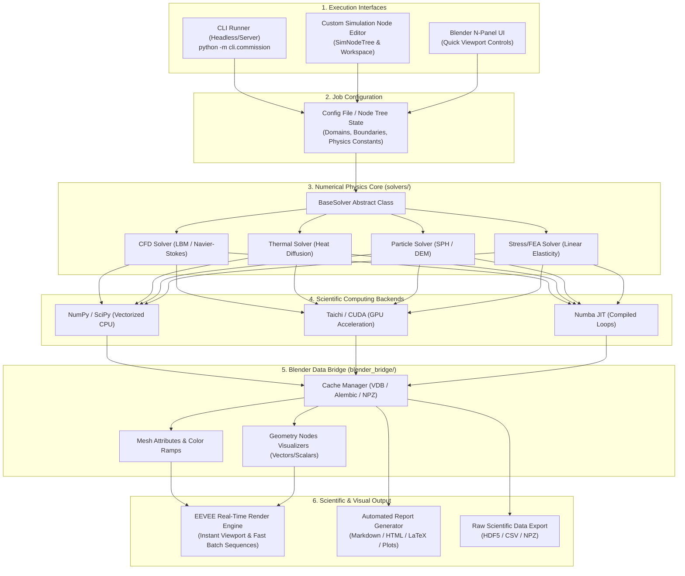

# System Architecture & Technical Specification

This document provides a technical overview and architectural blueprint for the **Simulation Assist (SimEngine)** framework inside Blender. It is intended as both an internal engineering guide and the basis for public community documentation and developer onboarding.

---

## 1. System Overview & Philosophy

Traditional Blender physics (smoke, fire, liquid, rigid bodies) are optimized for visual aesthetics rather than physical rigor or scientific measurement. **Simulation Assist** bridges the gap between scientific computing and photorealistic rendering by:
1. Running mathematically rigorous PDE and particle solvers powered by modern Python libraries (**NumPy, SciPy, Taichi, Numba**).
2. Bridging scientific arrays directly into Blender's mesh attributes, Geometry Nodes, and particle systems.
3. Enabling headless command-line commissioning (running batch simulations, parameter sweeps, and research jobs on remote servers or local workstations).
4. Automating camera setup, animation rendering (Cycles/EEVEE), and scientific report compilation (residual curves, conservation metrics, scalar slice plots).

---

## 2. High-Level Architecture Diagram



---

## 3. Subsystem Breakdown

### 3.1 Numerical Physics Core (`solvers/`)
All solvers inherit from `BaseSolver` to ensure a consistent API across CFD, thermal, particle, and mechanical stress domains:

```python
class BaseSolver(ABC):
    @abstractmethod
    def initialize(self, config: dict, domain_mesh: Optional[object] = None) -> None:
        """Initialize simulation grids, boundary conditions, and material constants."""
        pass

    @abstractmethod
    def step(self, dt: float) -> dict:
        """Advance simulation by time dt; return step metrics (residuals, energy)."""
        pass

    @abstractmethod
    def get_state(self) -> dict:
        """Return current scalar and vector fields (e.g., velocity, temperature, pressure)."""
        pass

    @abstractmethod
    def export_cache(self, frame_idx: int, output_dir: str) -> str:
        """Export state to disk (NPZ, OpenVDB, or PLY)."""
        pass
```

#### Supported & Roadmap Simulation Types:
1. **Fluid Dynamics & Aerodynamics (CFD)**:
   - **Lattice Boltzmann Method (LBM)**: D2Q9 / D3Q19 / D3Q27 lattice formulations for high-throughput GPU fluid simulations.
   - **Navier-Stokes Solvers**: Incompressible & compressible finite-difference/finite-volume schemes for internal/external aerodynamics.
   - **Multiphase Flows**: Volume-of-Fluid (VOF) and Level Set methods for liquid-gas interfaces and surface tension.
   - **Aerodynamic Analysis**: Drag/lift coefficients, boundary layer formation, and vortex shedding.

2. **Thermal & Thermodynamics**:
   - **Conduction**: Transient and steady-state heat equation ($\frac{\partial T}{\partial t} = \alpha \nabla^2 T + Q$).
   - **Convection**: Natural (Boussinesq buoyancy) and forced thermal convection coupled with fluid velocity.
   - **Radiation**: Surface-to-surface radiative heat exchange (Stefan-Boltzmann).
   - **Phase-Change Materials**: Solidification and melting with latent heat absorption/release.

3. **Mechanical, Structural & Finite Element Analysis (FEA)**:
   - **Linear & Non-linear Statics**: Displacement fields, stress ($\sigma$) and strain ($\varepsilon$) tensors, von Mises and Tresca yield criteria.
   - **Structural Dynamics**: Modal analysis, natural frequencies, vibration response, and harmonic damping.
   - **Contact Mechanics**: Elastic penalty contact, friction interfaces, and non-penetration constraints.

4. **Robotics, Kinematics & Multibody Dynamics (MBD)**:
   - **Rigid & Flexible Multibody Systems**: Articulated kinematic trees, closed-loop linkages, revolute/prismatic/spherical joints.
   - **Robot Description Formats**: Native import/export of URDF, SDF, and MJCF (MuJoCo) robot definitions.
   - **Kinematics & Actuation**: Forward/Inverse Kinematics (FK/IK), torque-limited actuators, PID motor controllers, back-EMF dynamics.
   - **Sensor Emulation**: Synthetic IMU sensors, LiDAR raycasting, RGB-D depth camera buffers, and tactile contact force estimation.
   - **Control Loop Co-simulation**: Python-based control loops (ROS 2 / Gymnasium / PyBullet / MuJoCo bridge).

5. **Particle, Granular & Discrete Element Methods (DEM / SPH)**:
   - **Smoothed Particle Hydrodynamics (SPH)**: Free-surface fluid flow, splashes, breaking waves, and fluid-structure interaction.
   - **Discrete Element Method (DEM)**: Granular material physics (sand, soil, powder, pharmaceuticals) with Hertzian contact and friction.
   - **Two-Way Coupling**: Fluid-particle suspensions, sediment transport, and aerosol dispersion.

6. **Electromagnetics & Multiphysics Coupling**:
   - **Electro-Thermal (Joule Heating)**: Electric potential $\nabla \cdot (\sigma \nabla V) = 0$ coupled with resistive heat generation.
   - **Magnetohydrodynamics (MHD)**: Lorentz force coupled with conductive fluid flow.
   - **Piezoelectric & Smart Materials**: Direct and inverse piezoelectric strain-voltage coupling.

7. **Acoustics & Wave Dynamics**:
   - **Acoustic Wave Equation**: Helmholtz solver for sound propagation and room acoustics.
   - **Aeroacoustics**: Noise generation and sound field prediction from fluid turbulence.

---

### 3.2 Blender Data Bridge (`blender_bridge/`)
The Blender Data Bridge is responsible for zero-copy or minimal-overhead data synchronization between scientific Python arrays and Blender's data structures:

1. **Mesh Attribute Injection (`mesh_attributes.py`)**:
   - Maps 1D/2D/3D NumPy arrays into Blender `mesh.attributes` (e.g., `temperature`, `pressure`, `von_mises_stress`).
   - Uses `foreach_set()` on attribute arrays for high-throughput memory transfers without Python per-vertex loops.
2. **Vector Field Visualizer (`vector_visualizer.py`)**:
   - Instantiates directional arrows or streamlines at grid points using Blender Geometry Nodes.
   - Sets orientation quaternions and scale vectors proportional to velocity or force vectors.
3. **Volume and Point Cloud Generation (`cache_manager.py`)**:
   - Writes dense grid data to OpenVDB grids for volume rendering with emission and absorption shaders.
   - Saves particle coordinates to point cloud objects for fast viewport manipulation.

---

### 3.3 Command-Line Interface (CLI) & Headless Commissioning (`cli/`)

The CLI enables fully automated, remote, or scripted execution.

#### Commissioning Pipeline Stages:
1. **Config Ingestion**: Parse experiment configuration file (JSON/YAML) specifying solver type, physical constants, boundary meshes, and output directories.
2. **Simulation Bake**: Initialize physics solver and compute frames sequentially. Progress bar and physical convergence metrics logged to stdout.
3. **Cache Serialization**: Save raw simulation state to disk (`.npz` or `.vdb`) for reproducibility.
4. **Blender Headless Render**:
   - Invoke Blender in background mode: `blender -b template.blend -P render_headless.py -- ...`
   - Load baked simulation data into the scene graph.
   - Execute **EEVEE** real-time rasterized render for each frame (sub-second per-frame rendering; avoids slow ray-tracing passes).
   - Encode final MP4 video or PNG sequence.
5. **Research Report Compilation**:
   - Calculate analytical metrics (energy conservation, Reynolds numbers, boundary heat fluxes).
   - Generate Matplotlib plots (cross-section heatmaps, residual decay graphs).
   - Compile into `report.html` and `report.md`.

#### Example CLI Commands:
```bash
# Commission a single thermal diffusion simulation
python -m cli.commission --solver thermal --config configs/heat_sink.json --steps 300 --render --report

# Run parameter sweep across multiple thermal conductivity values
python -m cli.commission --sweep configs/sweep_thermal.json --workers 4

# Run CFD commission directly inside Blender background process
blender -b -P cli/blender_runner.py -- --solver cfd --resolution 128 128 64 --reynolds 1000 --output ./runs/cfd_01
```

---

### 3.4 Automated Reporting Engine (`cli/report_generator.py`)
To accelerate scientific research, the tool generates publication-ready summaries:
- **Metrics Table**: Step count, simulation runtime, CFL stability condition, peak temperature/velocity.
- **Convergence Curves**: Loss / residual decay across iterations.
- **Physical Invariants**: Total mass and thermal energy tracked over time to prove numerical stability.
- **Visual Slices**: Matplotlib contour plots of 2D cross-sections.
- **Render Gallery**: Previews of final photorealistic renders alongside raw mathematical heatmaps.

---

### 3.5 Dedicated In-Blender Simulation Editor (`editor/` & `nodes/`)

To provide researchers and artists with an intuitive, non-cluttered workflow, the system introduces a **dedicated Simulation Editor** inside Blender:

#### 1. Custom Node Tree Editor (`bpy.types.NodeTree`)
Blender’s native Node Editor is extended with a custom tree type: `SimNodeTree` (`bl_idname = "SimNodeTree"`). In the Node Editor header, users can switch directly to **"SimEngine Nodes"**, allowing visual node graph composition of multi-physics setups:
- **Domain Nodes**: Define spatial bounds, grid resolution ($\Delta x$), time step ($\Delta t$), and voxel size.
- **Solver Nodes**: `CFD (LBM)` Solver, `Thermal Diffusion` Solver, `SPH Particle` Solver, `FEA Stress` Solver.
- **Boundary Condition Nodes**: Wall (No-Slip / Bounce-back), Constant Temperature (Dirichlet), Heat Flux (Neumann), Velocity Inlet, Pressure Outlet.
- **Physics & Force Nodes**: Gravity, Thermal Buoyancy (Boussinesq approximation), Viscous Drag, Surface Tension.
- **Output & Commissioning Nodes**: Mesh Attribute Mapper, OpenVDB/Alembic Cacher, Headless Render Trigger, and Research Report Generator.

#### 2. Node Graph Evaluation Engine (`nodes/evaluator.py`)
- Evaluates the dependency tree created by the user in the Node Editor.
- Translates the node network into a standardized simulation configuration dictionary (JSON-compatible).
- Can serialize the graph configuration directly to disk for immediate headless CLI execution.

#### 3. Dedicated Simulation Workspace (`SimEngine Workspace`)
- Automatic workspace setup in Blender with optimized screen areas:
  - **Main Viewport (3D)**: Pre-configured with attribute shading and vector display.
  - **Simulation Node Editor Area**: For assembling and modifying physics graphs.
  - **SimEngine Control Deck (Properties/Sidebar)**: Real-time baking progress bar, memory footprint monitor, CLI commission command builder, and report preview.

---

### 3.6 Blender Add-on UI Integration (`ui/`)
For quick adjustments without opening the full node editor:
- **N-Panel (`SimEngine`)**:
  - **Quick Setup**: Apply preset configurations (e.g., Wind Tunnel, Heated Fin, Water Dam Break).
  - **Domain Setup**: Select simulation bounding box or domain mesh.
  - **Physics Selector**: Choose CFD, Thermal, Particle SPH, or FEA.
  - **Material & Boundary Properties**: Set conductivity, fluid viscosity, inlet velocity, boundary temperatures.
  - **Bake & Playback Controls**: Bake simulation in background threads with live viewport status updates.
  - **Color Ramp & Attribute Mapping**: Select which attribute drives viewport shading (e.g., `velocity_mag` -> Turbo Color Map).

---

### 3.7 Dedicated EEVEE Real-Time Rendering Pipeline (`blender_bridge/camera_render.py`)

The rendering architecture is strictly locked to **EEVEE** (EEVEE-Next in Blender 4.2+ LTS) to deliver instantaneous visual inspection and fast batch exports:
- **Zero Offline Path-Tracing Bottlenecks**: Cycles requires path-traced samples, taking seconds or minutes per frame. EEVEE executes rasterized shader passes on the GPU in **tens of milliseconds per frame**.
- **Real-Time Interactive Viewport (60+ FPS)**: Researchers can scrub the timeline, rotate cameras, and inspect 3D vector fields and scalar heatmaps in real time with hardware-accelerated shaders.
- **Headless GPU Fast-Batch Export**: When commissioning via CLI (`--render`), EEVEE renders complete 500-frame scientific animations in under a minute directly through offscreen OpenGL/Vulkan contexts.
- **Real-Time Scientific Shading**:
  - Direct mesh attribute interpolation (`Attribute Node` -> `Color Ramp` -> `Emission`).
  - Screen Space Ambient Occlusion (SSAO) and Screen Space Reflections (SSR) for depth perception on mechanical models and CAD assemblies.
  - Volumetric density rendering for CFD smoke/vortex cores without compute-heavy volume step path-tracing.
  - Integrated Viewport Compositor for instantaneous false-color overlays and legend scales.

---

### 3.8 Google Colab Cloud Processing Bridge (`cli/colab_bridge.py` & `colab/`)

For computationally demanding multi-physics commissions (e.g., millions of DEM particles, fine 3D CFD meshes, or complex FEA inversions), the architecture supports offloading computation to Google Colab GPUs:
- **Zero-Local-Hardware Constraints**: Leverages Google Colab's NVIDIA T4, A100, or L4 GPUs via CUDA/Taichi acceleration without heating up local laptops or workstations.
- **Job Packager (`.simjob`)**: Compresses solver parameters, boundary geometry (`.obj`/`.ply`), and configuration JSON into an encrypted, lightweight archive.
- **Headless Cloud Execution**: A dedicated notebook (`colab/simengine_worker.ipynb`) pulls the `.simjob`, runs the solver at maximum GPU throughput, and streams progress metadata back.
- **Automated Cache Synchronization**: The resulting simulation caches (`.npz` arrays or OpenVDB files) are retrieved back to the local `cache/` directory, immediately binding to Blender's timeline for zero-latency EEVEE viewport playback.

---

## 4. Community Developer Guide: Adding a Custom Solver

To contribute a new solver (e.g., Wave Equation or Acoustic Simulation):

### Step 1: Subclass `BaseSolver`
Create `solvers/acoustic_wave.py`:
```python
from solvers.base_solver import BaseSolver
import numpy as np

class AcousticWaveSolver(BaseSolver):
    def initialize(self, config: dict, domain_mesh=None):
        self.nx, self.ny = config.get("grid_shape", (100, 100))
        self.c = config.get("speed_of_sound", 343.0)
        self.u = np.zeros((self.nx, self.ny), dtype=np.float32)
        self.u_prev = np.zeros_like(self.u)

    def step(self, dt: float) -> dict:
        # Finite-difference wave equation step
        laplacian = ... # compute laplacian
        u_next = 2 * self.u - self.u_prev + (self.c * dt)**2 * laplacian
        self.u_prev = self.u
        self.u = u_next
        return {"max_amplitude": float(np.max(np.abs(self.u)))}

    def get_state(self) -> dict:
        return {"wave_amplitude": self.u}

    def export_cache(self, frame_idx: int, output_dir: str) -> str:
        cache_path = f"{output_dir}/wave_{frame_idx:04d}.npz"
        np.savez_compressed(cache_path, amplitude=self.u)
        return cache_path
```

### Step 2: Register the Solver in Factory
Add the solver name to `solvers/__init__.py` in the solver registry mapping.

### Step 3: Add UI Properties (Optional)
Expose solver-specific constants (like `speed_of_sound`) in `ui/properties.py`.

### Step 4: Run via CLI or Blender
Test immediately via:
```bash
python -m cli.commission --solver acoustic --steps 100 --report
```

---

## 5. Performance & Hardware Acceleration Guidelines

1. **NumPy Vectorization**: Avoid nested Python `for` loops in computational hot paths. Always use vectorized array operations, slicing, or `np.einsum`.
2. **Taichi Lang Integration**: For large 3D grids ($> 256^3$) or high particle counts ($> 100,000$), implement compute kernels in Taichi (`@ti.kernel`), targeting CUDA, Vulkan, or Metal backends.
3. **Blender Data Transfer**: Always use `mesh.attributes['name'].data.foreach_set('value', flat_array)` instead of iterating over vertices in Python.
4. **Memory Management**: Stream simulation steps directly to disk caches to prevent exceeding RAM during multi-thousand-frame simulations.

---

## 6. Future Native CAD Modeling & Engineering Integration

To transform Blender from a polygonal visual asset modeler into a full engineering design and simulation environment, the architecture includes a roadmap for **Native CAD Modeling inside Blender**:

### 6.1 Exact Boundary Representation (B-Rep) Kernel
- Traditional Blender meshes are discrete polygon approximations. Engineering analysis (CFD, FEA, aerodynamics) requires exact geometry (true cylinders, spheres, analytic splines, fillets).
- **Kernel Integration**: Leverage OpenCASCADE Technology (OCCT) via Python kernels (**CadQuery** / **build123d** / **pythonocc**).
- **Native File Support**: Direct, lossless import and export of industry-standard CAD formats:
  - **STEP** (`.step`, `.stp` - AP203, AP214, AP242)
  - **IGES** (`.iges`, `.igs`)
  - **BREP** native solid files

### 6.2 Parametric 2D & 3D Constraint Sketcher
- Integrate a 2D geometric constraint solver (e.g., SolveSpace geometric solver bindings):
  - Sketching primitives: lines, arcs, circles, splines.
  - Constraints: coincident, horizontal/vertical, tangent, parallel, perpendicular, concentric, symmetric, dimension/distance.
- Parametric history tree: Extrude, Revolve, Sweep, Loft, Fillet, Chamfer, and Boolean operations with editable parameters.

### 6.3 Direct CAD-to-Simulation Conformal Meshing
- Direct bridge between exact CAD geometry and numerical simulation domains:
  - Eliminates poly-mesh artifacting (non-manifold edges, self-intersections, inverted normals).
  - Integration with robust tetrahedral and boundary-layer meshers (**Gmsh**, **Netgen**, **TetGen**).
  - Generates conformal volume meshes (Tet4, Tet10, Hex8) for FEA and boundary-fitted polyhedral prisms for CFD.

### 6.4 Associative Parametric Simulation Loops
- Changing a CAD parameter (e.g., wing angle of attack, pipe diameter, heat sink fin thickness):
  1. Triggers automatic CAD geometry rebuild.
  2. Regenerates conformal mesh for simulation domain.
  3. Re-runs simulation commission via CLI or background worker.
  4. Updates research metrics and render outputs in an automated design optimization loop (CAD $\to$ Sim $\to$ Report $\to$ Optimize).

