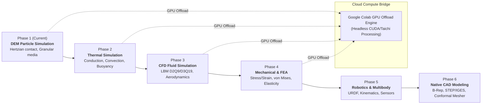
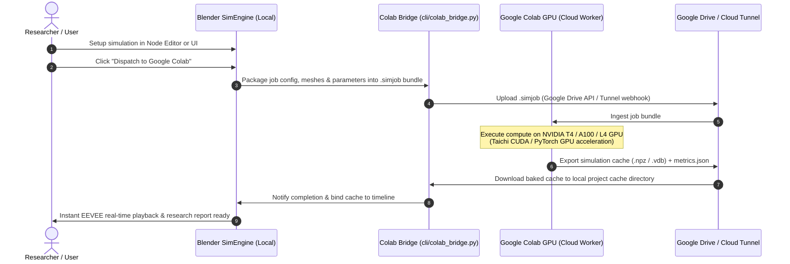

# Project Timeline & Development Roadmap

This document outlines the sequential development phases, milestones, technical deliverables, and cloud-compute offloading architecture for **Simulation Assist (SimEngine for Blender)**.

---

## 🗺️ Master Roadmap Overview

---

## 🎯 Phase Breakdown & Milestones

### Phase 1: DEM Particle Simulation Tool (First Step — Current)
**Focus**: Discrete Element Method (DEM) for granular dynamics, powder flow, and particle interactions.

* **Core Numerical Engine**:
  - [ ] Implement `solvers/particle_dem.py` inheriting from `BaseSolver`.
  - [ ] Normal contact force using Hertzian non-linear contact theory ($F_n \propto \delta_n^{3/2}$) with normal restitution damping.
  - [ ] Tangential force with Mindlin-Deresiewicz compliance and Coulomb sliding friction ($\mu |F_n|$).
  - [ ] Spatial partitioning: Fast neighbor search via Uniform Spatial Grid / Linked-Cell binning in NumPy/Taichi.
  - [ ] Time integration: Velocity-Verlet symplectic integrator for energy conservation.
* **Visual 3D Model Preparation Tools (prep/)**:
  - [ ] `prep/mesh_inspector.py`: Viewport overlay highlighting non-manifold edges, open boundaries, and flipped normals.
  - [ ] `prep/geometry_healer.py`: Automated watertight hole capping, normal re-orientation, and defeaturing for containers/hoppers.
  - [ ] `prep/boundary_tagger.py`: Interactive 3D face tagger to designate collider boundaries, emitters, and obstacle friction properties.
  - [ ] `prep/voxelizer_sdf.py`: GPU Signed Distance Field (SDF) generator for sub-microsecond particle-mesh collision queries.
* **Blender Data Bridge & EEVEE Visualization**:
  - [ ] `blender_bridge/particle_pointcloud.py`: Convert simulation positions to Blender Point Clouds / Particle instances.
  - [ ] Real-time attribute binding: particle velocity magnitude, contact force intensity, kinetic energy.
  - [ ] EEVEE real-time viewport shading with color ramps.
* **Dedicated Node Editor & Workspace**:
  - [ ] Custom `SimNodeTree` with DEM Particle Emitter Node, Physical Domain Node, Obstacle/Collider Node, and DEM Solver Node.
  - [ ] One-click "SimEngine Studio" Workspace.
* **CLI & Reporting**:
  - [ ] CLI command: `python -m cli.commission --solver dem --config configs/dem_hopper.json --render --report`.
  - [ ] Research report tracking kinetic energy dissipation, particle velocity distributions, and flow rate metrics.

---

### Phase 2: Thermal Simulation Tool
**Focus**: Heat diffusion, conjugate heat transfer, and thermal boundary conditions.

* **Core Numerical Engine**:
  - [ ] Implement `solvers/thermal_diff.py`.
  - [ ] Explicit FTCS finite-difference solver with automated Fourier CFL stability limiter ($Fo \le 1/6$).
  - [ ] Implicit Crank-Nicolson solver for unconditionally stable large timesteps.
  - [ ] Boundary conditions: Dirichlet (constant temperature), Neumann (heat flux), and Robin (Newton's cooling convection).
  - [ ] Enthalpy method for phase-change materials (melting and solidification).
* **Blender & EEVEE Bridge**:
  - [ ] Vertex color / mesh attribute injection for surface temperature heatmaps (`Turbo` / `Viridis` color ramps).
* **CLI & Reporting**:
  - [ ] Automated heat flux calculations, thermal energy conservation tracking, and 2D isothermal slice contour plots.

---

### Phase 3: CFD (Computational Fluid Dynamics) Simulation Tool
**Focus**: Dual-engine CFD — High-throughput GPU Lattice Boltzmann Method (LBM) + Industrial-grade **OpenFOAM** integration.

* **Core Numerical Engines**:
  - [ ] **LBM Solver (`solvers/cfd_lbm.py`)**: D2Q9 / D3Q19 BGK solver with bounce-back and Zou-He boundaries for real-time GPU fluid flow.
  - [ ] **OpenFOAM Bridge (`solvers/cfd_openfoam.py`)**:
    - [ ] Automated case directory generator (`0/`, `constant/`, `system/` files from Node Tree configuration).
    - [ ] Geometry meshing bridge using `blockMesh` and `snappyHexMesh` via `meshio`.
    - [ ] Solver integration: `simpleFoam` (steady turbulent), `pimpleFoam` (transient aerodynamic), `interFoam` (two-phase free surface VOF), and `chtMultiRegionFoam` (conjugate heat transfer).
    - [ ] Native output parser using `fluidfoam` and `pyvista` for reading pressure $p$, velocity $\mathbf{U}$, and turbulence fields ($k$, $\omega$, $\epsilon$).
  - [ ] Multiphase flows (Volume-of-Fluid / Level Set) and natural convection coupling (Boussinesq buoyancy).
* **Blender & EEVEE Bridge**:
  - [ ] Velocity vector arrows and streamlines via Geometry Nodes.
  - [ ] OpenVDB cache export for real-time smoke and vorticity volume visualization in EEVEE.
* **CLI & Reporting**:
  - [ ] Automated calculation of drag ($C_d$) and lift ($C_l$) coefficients, pressure drops, OpenFOAM residual monitoring, and velocity field plots.

---

### Phase 4: Mechanical & Structural FEA Simulation Tool
**Focus**: Stress, strain, structural deflection, and failure criteria.

* **Core Numerical Engine**:
  - [ ] Implement `solvers/fea_stress.py`.
  - [ ] Generalized 3D Hooke's law, Cauchy stress tensor, and infinitesimal strain calculation.
  - [ ] Equivalent von Mises stress field and Factor of Safety (FoS) estimation.
  - [ ] Linear static Galerkin finite-element stiffness matrix solver ($\mathbf{K} \mathbf{u} = \mathbf{F}$).
* **Blender & EEVEE Bridge**:
  - [ ] Real-time mesh deformation visualizer with exaggeration scale factor slider.
  - [ ] Stress concentration heatmaps rendered directly on mesh surfaces.
* **CLI & Reporting**:
  - [ ] Critical stress zones, displacement plots, and safety factor compliance tables.

---

### Phase 5: Robotics, Kinematics & Multibody Dynamics
**Focus**: Articulated robot chains, URDF import, actuators, and sensor emulation.

* **Core Deliverables**:
  - [ ] URDF / SDF / MJCF robot description parser.
  - [ ] Forward/Inverse Kinematics (FK/IK) with Damped Least Squares Jacobian.
  - [ ] Euler-Lagrange equations of motion ($\mathbf{M}\ddot{\mathbf{q}} + \mathbf{C}\dot{\mathbf{q}} + \mathbf{g} = \boldsymbol{\tau}$).
  - [ ] Actuator PID torque controllers and sensor raycasting (synthetic LiDAR, depth camera).

---

### Phase 6: Native CAD Modeling Integration
**Focus**: Exact B-Rep solid modeling, STEP/IGES exchange, and conformal simulation meshing.

* **Core Deliverables**:
  - [ ] OpenCASCADE Technology (OCCT) integration via CadQuery / build123d.
  - [ ] Lossless STEP and IGES file import and export in Blender.
  - [ ] 2D parametric geometric constraint sketcher.
  - [ ] Direct conformal tetrahedral mesher (Gmsh / Netgen) bridging CAD solids to FEA/CFD domains.

---

## ☁️ Google Colab Cloud Processing Bridge

For compute-intensive simulations (e.g., hundreds of thousands of DEM particles or high-resolution 3D grids) where local hardware is constrained, the system includes a dedicated **Google Colab Cloud Bridge**.

### Architecture of the Google Colab Feature:
1. **Lightweight Job Bundler (`cli/colab_bridge.py`)**:
   - Serializes the simulation parameters, boundary meshes (`.obj` / `.ply`), and solver configuration into a compact `.simjob` archive.
2. **Colab Notebook Worker (`colab/simengine_worker.ipynb`)**:
   - A ready-to-run Jupyter notebook configured with free or Pro GPU runtimes (NVIDIA T4 / V100 / A100 / L4).
   - Installs environment dependencies in one click (`pip install taichi numpy scipy`).
   - Runs headless execution of the selected solver (DEM, Thermal, CFD) using CUDA hardware acceleration.
3. **Seamless Synchronization Options**:
   - **Mode A (Google Drive Sync)**: Mounts Google Drive in Colab; jobs saved in a designated Drive folder are automatically computed and synced back to the local machine.
   - **Mode B (Live Tunnel / REST API via ngrok / cloudflared)**: Colab runs a lightweight background FastAPI worker; Blender communicates directly over HTTPS with live progress updates streamed to Blender's sidebar monitor.

